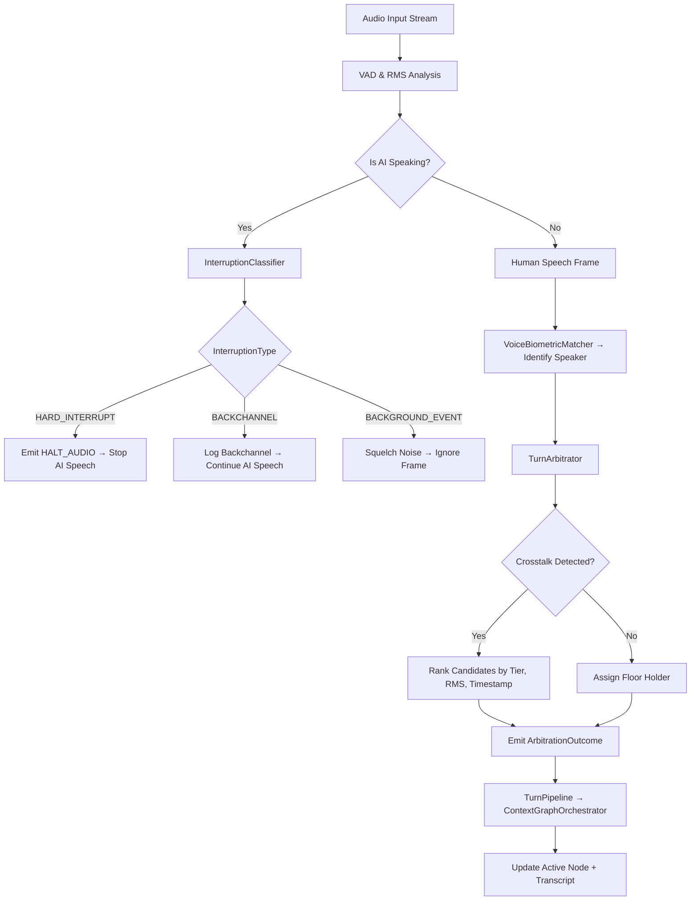
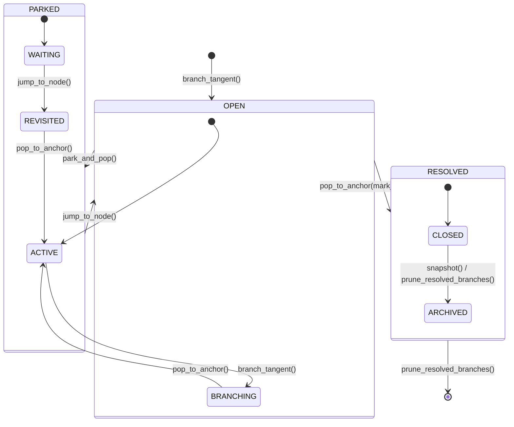

# SquelchGrip Backend (`squelch_grip_backend`) — v1.0-alpha

Foundational core engine for **SquelchGrip**, a full-duplex, multi-speaker voice management and non-linear conversational context graph orchestrator.

## Repository Structure

```text
squelch_grip_backend/
├── api/
│   ├── __init__.py
│   └── server.py
├── schemas/
│   ├── __init__.py
│   ├── session_models.py
│   ├── lexicon_models.py
│   ├── turn_models.py
│   ├── prompt_models.py
│   └── navigation_models.py
├── core/
│   ├── __init__.py
│   ├── state_manager.py
│   ├── context_graph.py
│   ├── voice_biometrics.py
│   ├── interruption_classifier.py
│   ├── lexicon_manager.py
│   ├── navigation_detector.py
│   ├── turn_pipeline.py
│   └── prompt_compiler.py
├── tests/
│   ├── __init__.py
│   ├── test_context_graph.py
│   ├── test_biometrics_and_classifier.py
│   ├── test_lexicon_manager.py
│   ├── test_turn_pipeline.py
│   ├── test_prompt_compiler.py
│   ├── test_navigation_detector.py
│   └── test_api_server.py
├── pyproject.toml
├── requirements.txt
├── AGENTS.md
└── README.md
```

## Architecture & State Machine Diagrams

### 1. Full-Duplex TurnPipeline & Crosstalk Arbitration Flow



### 2. ContextNode Lifecycle & Navigation State Machine



### 3. Module Responsibility Matrix

| Module | Responsibility | Key Classes / Functions | Dependencies |
| :--- | :--- | :--- | :--- |
| `core/context_graph.py` | Non-linear conversation tree management | `ContextGraphOrchestrator`, `ContextNode` | `schemas.session_models` |
| `core/interruption_classifier.py` | Classify overlapping speech events | `InterruptionClassifier`, `BargeInDirective` | `schemas.session_models` |
| `core/voice_biometrics.py` | Speaker identification via cosine similarity | `VoiceBiometricMatcher`, `VoiceProfile` | `math`, `schemas.session_models` |
| `core/turn_arbitrator.py` | Resolve multi-speaker collisions | `TurnArbitrator`, `ArbitrationOutcome` | `schemas.arbitration_models` |
| `core/navigation_detector.py` | Detect conversational navigation intents | `NavigationIntentDetector`, `NavigationDecision` | `schemas.navigation_models` |
| `core/lexicon_manager.py` | Normalize domain-specific terms | `LexiconManager`, `LexiconPack` | `schemas.lexicon_models` |
| `core/prompt_compiler.py` | Compile deterministic LLM prompt & delta packets | `ContextPromptCompiler`, `CompiledContextPacket`, `ContextDeltaPacket` | `schemas.prompt_models` |
| `core/state_manager.py` | Manage active room/session state | `SessionStateManager`, `RoomState` | `schemas.session_models` |
| `core/session_store.py` | Persist and restore snapshots | `SessionSnapshotStore`, `RoomSnapshot` | `schemas.snapshot_models` |
| `core/turn_pipeline.py` | End-to-end async turn processing & diagnostics | `TurnPipeline`, `TurnProcessingResult`, `RoomDiagnosticsReport` | All `core` & `schemas` modules |
| `api/server.py` | REST + WebSocket interface | FastAPI endpoints & room broadcaster | `core.*`, `schemas.*` |

## Quickstart

### 1. Install Dependencies
```bash
python -m pip install -r requirements.txt
```

### 2. Run Tests
```bash
python -m pytest -v
```

### 3. Run Server (Native or Docker)
```bash
python -m uvicorn api.server:app --host 127.0.0.1 --port 8000 --reload
# or via Docker:
docker compose up --build -d
```
